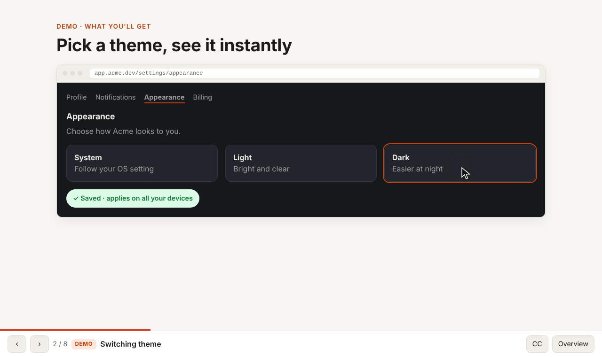
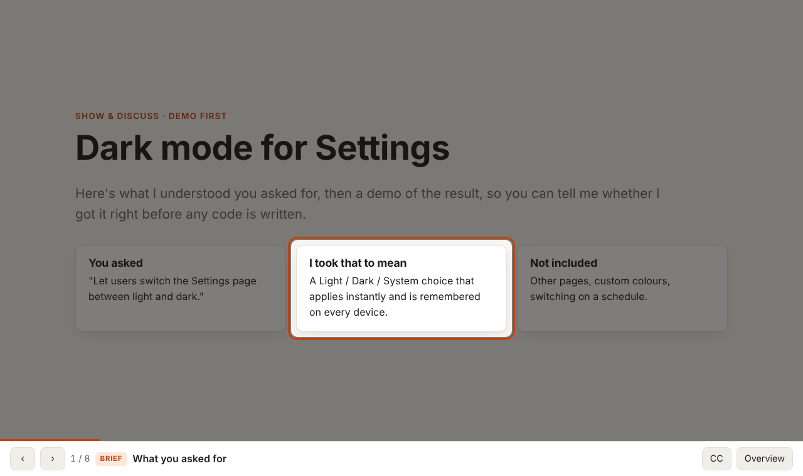
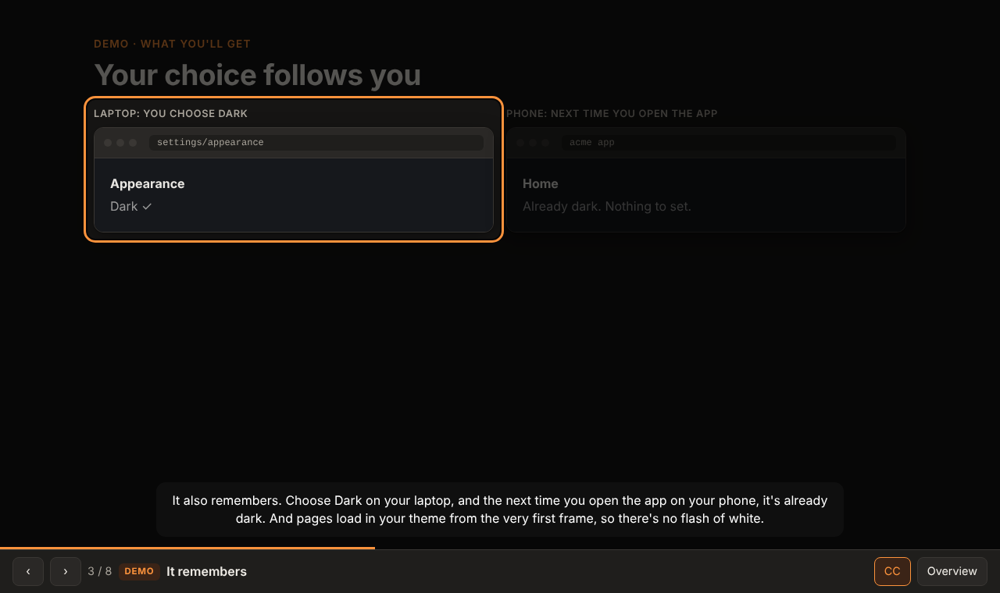
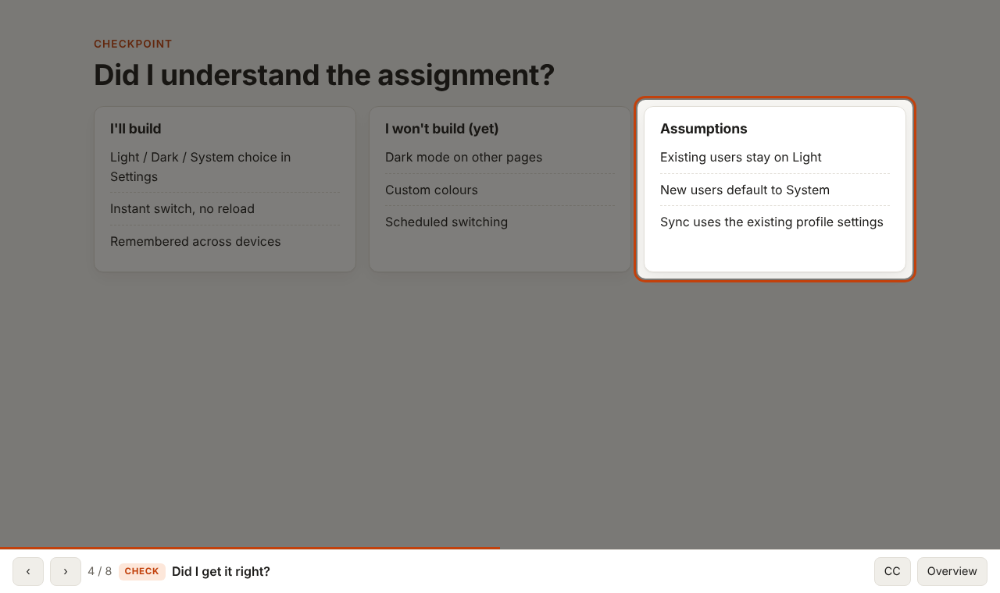
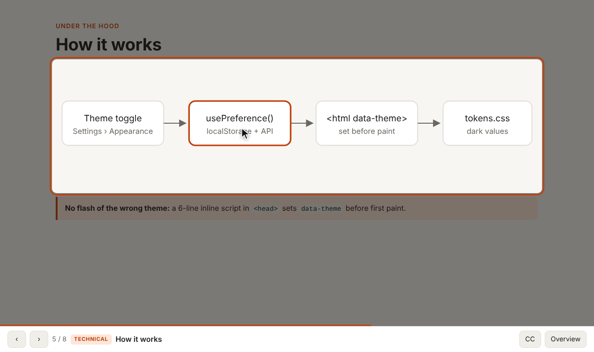
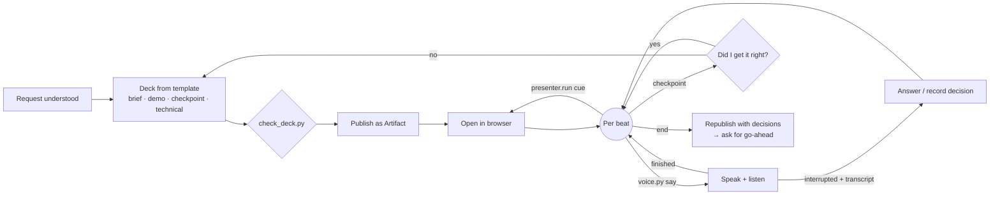

<div align="center">

# Show and Discuss

**A Claude Code skill that demos what Claude is about to build before it builds it.**

Before writing any code, Claude shows you a working mock of the result: it
clicks through it in your browser and narrates as it goes. Then it asks
*"Did I get it right?"* Only after you confirm does it go into the technical
plan, and only as deep as you want. Interrupt at any time by just talking.

[](https://github.com/EhsanRS/ClaudeCode-Show-and-Discuss-skill/actions/workflows/ci.yml)
[](LICENSE)
[](https://code.claude.com/docs/en/plugins)




</div>

## Why

The costliest misunderstanding is one you discover after the code is written.
A plan in chat is easy to skim and easy to misread. A demo isn't: you see the
result and immediately know whether it's what you meant. Then the
implementation discussion has something concrete to anchor to.

The skill runs a short meeting, like a stand-up or lab-meeting demo:

| Step | What happens |
|---|---|
| **1. Brief** | *You asked…* / *I took that to mean…* / *Not included…* |
| **2. Demo** | The finished result in use: a clickable mock (or a terminal session, API exchange, before/after) driven by an on-screen pointer and narrated aloud. |
| **3. Checkpoint** | *"Did I get it right?"* Claude stops and listens. If it's off, Claude revises the demo and shows it again. |
| **4. Technical** *(optional)* | How it will be built: approach, slices, risks, at whatever depth you ask for. |
| **5. Decisions** | What you agreed is recorded live on the last slide. The deck is republished as a record, and Claude waits for your go-ahead. |

It works for more than features: slice reviews, stand-ups ("here's what's
done"), lab-meeting results and design reviews follow the same
show-first pattern.

## Install

In Claude Code:

```text
/plugin marketplace add EhsanRS/ClaudeCode-Show-and-Discuss-skill
/plugin install show-and-discuss@show-and-discuss
```

Or from a shell:

```bash
claude plugin marketplace add EhsanRS/ClaudeCode-Show-and-Discuss-skill
claude plugin install show-and-discuss@show-and-discuss
```

<details>
<summary>Install as a standalone skill instead (no plugin)</summary>

```bash
git clone https://github.com/EhsanRS/ClaudeCode-Show-and-Discuss-skill.git
mkdir -p ~/.claude/skills
cp -r ClaudeCode-Show-and-Discuss-skill/plugins/show-and-discuss/skills/present ~/.claude/skills/present
```

It is then invoked as `/present` instead of `/show-and-discuss:present`.
</details>

## Use

Once you and Claude have a plan:

```text
/show-and-discuss:present the dark-mode settings feature
```

Or just ask: *"Demo what you're going to build before you start."* When a
plan has just been agreed, Claude may also **offer** a demo. It won't start
without you.

During the presentation:

| You… | Claude… |
|---|---|
| say nothing | walks through the demo, clicking and pointing as it narrates |
| start talking (any time) | stops mid-sentence, listens, then answers |
| say "that's not what I meant…" | restates the corrected understanding, records it, and re-demos if needed |
| say "yes, that's it" at the checkpoint | asks whether you want the technical walkthrough or to skip to decisions |
| say "show that again" / "skip to the tech" | replays the demo or navigates |
| say "looks good, go ahead" | updates the deck and plan, then starts implementing |

<table>
<tr>
<td></td>
<td></td>
</tr>
<tr>
<td align="center"><sub><b>Brief:</b> Claude's understanding, stated up front</sub></td>
<td align="center"><sub><b>Demo:</b> step-by-step reveal with captions (dark theme)</sub></td>
</tr>
<tr>
<td></td>
<td></td>
</tr>
<tr>
<td align="center"><sub><b>Checkpoint:</b> "Did I get it right?"</sub></td>
<td align="center"><sub><b>Technical</b> (optional): the how, on request</sub></td>
</tr>
</table>

## What works where

The skill checks what's available and uses the best mode it can. It never
blocks.

| Mode | Needs | Experience | Typical surface |
|---|---|---|---|
| **Full** | Artifacts + a browser tool + local audio | Spoken demo, driven by Claude's pointer; interrupt by talking | CLI or desktop app on your machine |
| **Show** | Artifacts + a browser tool | Pointer-driven demo; narration and questions in chat | Same, without a mic or speakers |
| **Share** | Artifacts | You open the link and click through the (interactive) demo; Claude narrates in chat | Anywhere artifacts work |
| **Local** | Nothing extra | Deck as a local HTML file; walkthrough in chat | Fallback, e.g. web sessions |

- **Artifacts** need a claude.ai Pro, Max, Team or Enterprise login
  ([docs](https://code.claude.com/docs/en/artifacts)).
- **Browser:** [Claude in Chrome](https://code.claude.com/docs/en/chrome) (CLI,
  VS Code, desktop) or the desktop app's built-in browser pane.
- **Voice** runs locally through the bundled helper, so it isn't available in
  cloud sessions (claude.ai/code), which have no audio device.

## Voice setup

Voice works out of the box with free, offline components:

- **Speaking:** your system voice (macOS `say`, `espeak-ng` or
  [Piper](https://github.com/rhasspy/piper) on Linux, SAPI on Windows).
- **Listening:** [faster-whisper](https://github.com/SYSTRAN/faster-whisper)
  running locally. Your audio never leaves your machine.

You need [`uv`](https://docs.astral.sh/uv/) (recommended; it installs the Python
dependencies automatically) or Python 3.10+ with
`pip install -r plugins/show-and-discuss/skills/present/scripts/requirements.txt`.
On Linux also install PortAudio: `sudo apt install libportaudio2 espeak-ng`.

**For a natural voice, add ElevenLabs** (optional; free tier ≈ 10 min of
speech/month, non-commercial):

```bash
export ELEVENLABS_API_KEY=sk_...           # enables ElevenLabs voices automatically
export ELEVENLABS_VOICE_ID=JBFqnCBsd6RMkjVDRZzb   # optional: pick any voice
export SHOW_DISCUSS_STT=scribe             # optional: ElevenLabs transcription too
```

If ElevenLabs fails (quota or network), the helper switches to the system voice
mid-presentation. Check that everything works with:

```bash
uv run plugins/show-and-discuss/skills/present/scripts/voice.py doctor
```

**Use headphones** for the best experience. Without them, the mic can hear
the narration, so the helper uses a stricter threshold while it's speaking. All
settings, troubleshooting and privacy details are in
[`references/voice.md`](plugins/show-and-discuss/skills/present/references/voice.md).

## How it works



| Piece | Role |
|---|---|
| [`SKILL.md`](plugins/show-and-discuss/skills/present/SKILL.md) | The workflow Claude follows: understand → check capabilities → build → publish → demo → checkpoint → (technical) → wrap up. |
| [`presenter-template.html`](plugins/show-and-discuss/skills/present/assets/presenter-template.html) | A self-contained, theme-aware deck with interactive demo mocks (states, clicks, typing, reveals) and a `window.presenter` API (pointer, spotlight, captions, beats, decisions), plus hash deep-links and keyboard controls. |
| [`voice.py`](plugins/show-and-discuss/skills/present/scripts/voice.py) | Speaks text while monitoring the mic. When you start talking it stops, records and transcribes, then returns JSON to Claude. |
| [`check_deck.py`](plugins/show-and-discuss/skills/present/scripts/check_deck.py) | Validates a deck before publishing (notes, unique spots, valid cues and demo actions, a checkpoint, allowed scripts). |

Design decisions and their rationale are in
[`docs/architecture.md`](docs/architecture.md).

## Privacy

- **Default (system voice + local Whisper):** nothing leaves your machine
  except the artifact, which is a private page on claude.ai until you share it.
- **With an ElevenLabs key:** narration text is sent to ElevenLabs. With
  `SHOW_DISCUSS_STT=scribe`, your recorded questions are sent too.

## Contributing

Issues and pull requests are welcome. See [CONTRIBUTING.md](CONTRIBUTING.md)
for the development setup and how to test changes.

## License

[Apache 2.0](LICENSE)
