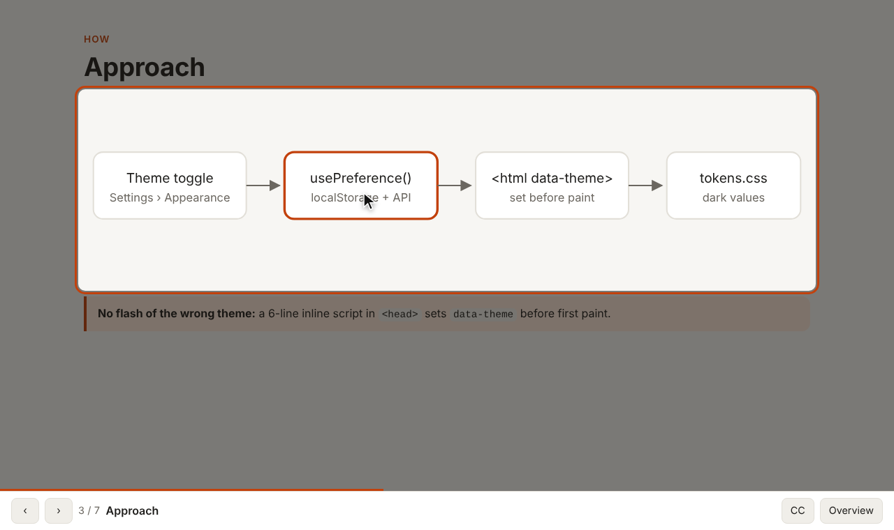
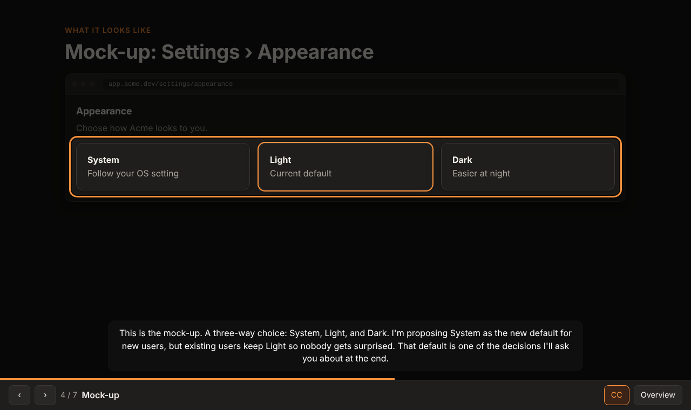
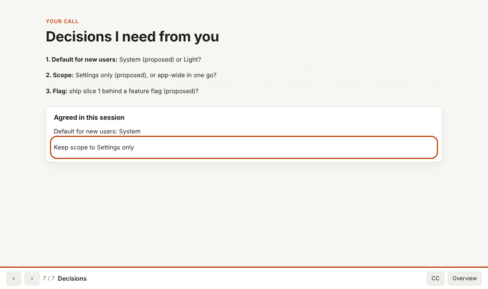
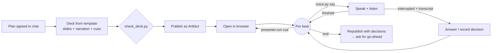

<div align="center">

# Show and Discuss

**A Claude Code skill that presents the plan before building it.**

Claude turns its plan into a short slide deck with mock-ups and diagrams, opens
it in your browser, points at things while it talks you through it, and stops
to discuss whenever you speak, the way a stand-up or lab meeting works. Nothing
gets built until you've agreed.

[](https://github.com/EhsanRS/ClaudeCode-Show-and-Discuss-skill/actions/workflows/ci.yml)
[](LICENSE)
[](https://code.claude.com/docs/en/plugins)




</div>

## Why

Plans in chat are easy to skim and hard to discuss. People build shared
understanding by seeing the thing, hearing the reasoning, and interrupting
with "wait, why not…?". This skill gives Claude that format:

1. **Show.** Claude builds an [artifact](https://code.claude.com/docs/en/artifacts):
   a self-contained slide deck with what's being built, why, how, UI mock-ups,
   the slice breakdown, risks and the decisions it needs from you.
2. **Walk through.** Claude opens it in the browser and drives it: an animated
   pointer, spotlights, scrolling, captions.
3. **Discuss.** Claude narrates out loud. Start talking at any moment and it
   stops, listens, answers, and records decisions on the final slide.
4. **Agree, then build.** The deck is updated with what you agreed and stays as
   a shareable record. Implementation starts only after your go-ahead.

It isn't only for code. It also fits slice reviews, stand-ups, lab-meeting
results and design reviews.

## Install

In Claude Code:

```text
/plugin marketplace add EhsanRS/ClaudeCode-Show-and-Discuss-skill
/plugin install show-and-discuss@show-and-discuss
```

Or from a shell:

```bash
claude plugin marketplace add EhsanRS/ClaudeCode-Show-and-Discuss-skill
claude plugin install show-and-discuss@show-and-discuss
```

<details>
<summary>Install as a standalone skill instead (no plugin)</summary>

```bash
git clone https://github.com/EhsanRS/ClaudeCode-Show-and-Discuss-skill.git
mkdir -p ~/.claude/skills
cp -r ClaudeCode-Show-and-Discuss-skill/plugins/show-and-discuss/skills/present ~/.claude/skills/present
```

It is then invoked as `/present` instead of `/show-and-discuss:present`.
</details>

## Use

Once you and Claude have a plan:

```text
/show-and-discuss:present the plan for the dark-mode settings page
```

Or just ask: *"Present this plan to me before you start."* When a plan has
just been agreed, Claude may also **offer** to present it. It won't start
without you.

During the presentation:

| You… | Claude… |
|---|---|
| say nothing | narrates slide by slide, pointing at what it's describing |
| start talking (any time) | stops mid-sentence, listens, then answers |
| ask "why not X?" | answers, spotlighting the relevant part, and checks for more questions |
| say "let's drop slice 3" | confirms it and adds it to **Agreed in this session** |
| say "go back" / "skip to risks" | navigates |
| say "looks good, go ahead" | updates the deck and plan, then starts implementing |

<table>
<tr>
<td></td>
<td></td>
</tr>
<tr>
<td align="center"><sub>Mock-ups, spotlight and captions (dark theme)</sub></td>
<td align="center"><sub>Decisions recorded live during the discussion</sub></td>
</tr>
</table>

## What works where

The skill checks what's available and uses the best mode it can. It never
blocks.

| Mode | Needs | Experience | Typical surface |
|---|---|---|---|
| **Full** | Artifacts + a browser tool + local audio | Spoken walkthrough with pointer; interrupt by talking | CLI or desktop app on your machine |
| **Show** | Artifacts + a browser tool | Pointer walkthrough; narration and questions in chat | Same, without a mic or speakers |
| **Share** | Artifacts | You open the link; Claude walks through it in chat | Anywhere artifacts work |
| **Local** | Nothing extra | Deck as a local HTML file; walkthrough in chat | Fallback, e.g. web sessions |

- **Artifacts** need a claude.ai Pro, Max, Team or Enterprise login
  ([docs](https://code.claude.com/docs/en/artifacts)).
- **Browser:** [Claude in Chrome](https://code.claude.com/docs/en/chrome) (CLI,
  VS Code, desktop) or the desktop app's built-in browser pane.
- **Voice** runs locally through the bundled helper, so it isn't available in
  cloud sessions (claude.ai/code), which have no audio device.

## Voice setup

Voice works out of the box with free, offline components:

- **Speaking:** your system voice (macOS `say`, `espeak-ng` or
  [Piper](https://github.com/rhasspy/piper) on Linux, SAPI on Windows).
- **Listening:** [faster-whisper](https://github.com/SYSTRAN/faster-whisper)
  running locally. Your audio never leaves your machine.

You need [`uv`](https://docs.astral.sh/uv/) (recommended; it installs the Python
dependencies automatically) or Python 3.10+ with
`pip install -r plugins/show-and-discuss/skills/present/scripts/requirements.txt`.
On Linux also install PortAudio: `sudo apt install libportaudio2 espeak-ng`.

**For a natural voice, add ElevenLabs** (optional; free tier ≈ 10 min of
speech/month, non-commercial):

```bash
export ELEVENLABS_API_KEY=sk_...           # enables ElevenLabs voices automatically
export ELEVENLABS_VOICE_ID=JBFqnCBsd6RMkjVDRZzb   # optional: pick any voice
export SHOW_DISCUSS_STT=scribe             # optional: ElevenLabs transcription too
```

If ElevenLabs fails (quota or network), the helper switches to the system voice
mid-presentation. Check that everything works with:

```bash
uv run plugins/show-and-discuss/skills/present/scripts/voice.py doctor
```

**Use headphones** for the best experience. Without them, the mic can hear
the narration, so the helper uses a stricter threshold while it's speaking. All
settings, troubleshooting and privacy details are in
[`references/voice.md`](plugins/show-and-discuss/skills/present/references/voice.md).

## How it works



| Piece | Role |
|---|---|
| [`SKILL.md`](plugins/show-and-discuss/skills/present/SKILL.md) | The workflow Claude follows: ground → check capabilities → build → publish → present and discuss → wrap up. |
| [`presenter-template.html`](plugins/show-and-discuss/skills/present/assets/presenter-template.html) | A self-contained, theme-aware deck with a `window.presenter` API (pointer, spotlight, captions, beats, decisions), hash deep-links and keyboard controls. |
| [`voice.py`](plugins/show-and-discuss/skills/present/scripts/voice.py) | Speaks text while monitoring the mic. When you start talking it stops, records and transcribes, then returns JSON to Claude. |
| [`check_deck.py`](plugins/show-and-discuss/skills/present/scripts/check_deck.py) | Validates a deck before publishing (notes present, unique spots, valid cues, allowed scripts). |

Design decisions and their rationale are in
[`docs/architecture.md`](docs/architecture.md).

## Privacy

- **Default (system voice + local Whisper):** nothing leaves your machine
  except the artifact, which is a private page on claude.ai until you share it.
- **With an ElevenLabs key:** narration text is sent to ElevenLabs. With
  `SHOW_DISCUSS_STT=scribe`, your recorded questions are sent too.

## Contributing

Issues and pull requests are welcome. See [CONTRIBUTING.md](CONTRIBUTING.md)
for the development setup and how to test changes.

## License

[Apache 2.0](LICENSE)
